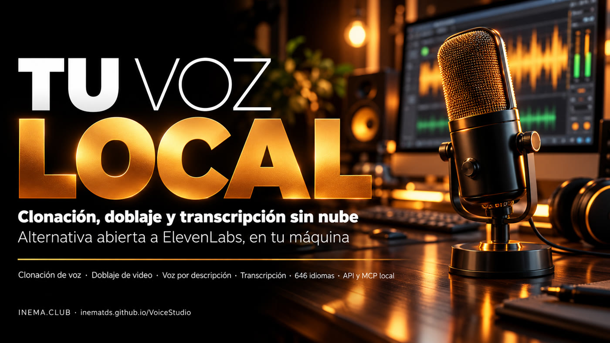

# VoiceStudio

[](https://inematds.github.io/VoiceStudio/guia/es/)

**🇧🇷 [Português](README.md) · 🇺🇸 [English](README.en.md) · 🇪🇸 [Español](README.es.md)**

## Qué es

VoiceStudio es un programa gratuito y de código abierto que hace en tu computadora lo que servicios pagos como ElevenLabs hacen en la nube. Copia una voz a partir de unos segundos de grabación, crea voces nuevas a partir de una descripción en texto, dobla videos y transcribe audio en 646 idiomas. Sirve para quien produce videos, cursos, podcasts o audiolibros y quiere narración sin pagar por minuto ni enviar el audio afuera. Necesitas una computadora con unos 10 GB libres; con tarjeta de video NVIDIA es mucho más rápido.

## 📖 Guía de uso

Guía completa (landing + paso a paso): **https://inematds.github.io/VoiceStudio/guia/es/**

## Origen y licencia

Este repositorio es un **espejo** de [debpalash/VoiceStudio](https://github.com/debpalash/VoiceStudio), mantenido por [INEMA.CLUB](https://inema.club) con la guía en portugués, inglés y español. Todo el código es del proyecto original, bajo la licencia **AGPL-3.0** ([LICENSE](LICENSE), [LICENSE-NOTICE.md](LICENSE-NOTICE.md)). Los modelos de voz tienen licencias propias. Clona voces solo con permiso de quien habla.

- README original (en inglés): [README.upstream.md](README.upstream.md)
- Documentación oficial: [docs/](docs/)
- Para la versión más reciente, prefiere el repositorio original.

## Instalación rápida

```sh
# macOS / Linux x86_64
curl -fsSL https://voicestudio.sh/install | sh

# desde el código fuente (también Linux ARM64)
git clone https://github.com/inematds/VoiceStudio.git
cd VoiceStudio && bun install && bun run setup:api && bun run dev
```
